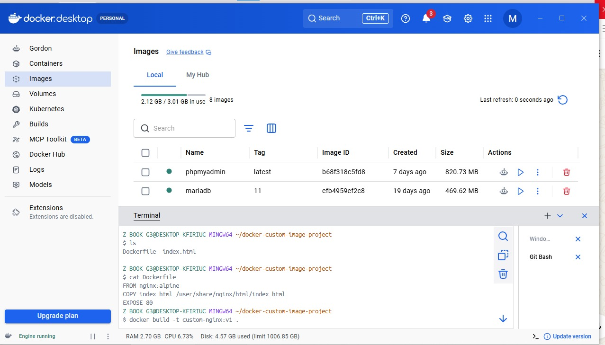

# Ì∞≥ Docker Custom Image Project

A hands-on Docker project demonstrating how to build a custom Docker image using a Dockerfile, run a container from the image, and serve a custom HTML webpage using Nginx.

## Ì≥å Project Overview

This project demonstrates the complete process of creating and running a custom Docker image.

The project includes:

- Creating a custom HTML webpage
- Writing a Dockerfile
- Using Nginx Alpine as the base image
- Building a custom Docker image
- Running a container from the custom image
- Publishing the container using port mapping
- Accessing the website through a web browser

## ÌøóÔ∏è Project Architecture

```text
Browser
   |
   | localhost:8082
   v
Docker Host
   |
   | Port Mapping 8082:80
   v
Docker Container
   |
   | Nginx Web Server
   v
Custom index.html
```

## Ì≥Ç Project Structure

```text
docker-custom-image-project/
├── Dockerfile
├── index.html
├── README.md
└── screenshots/
    ├── Container is created.jpeg
    ├── Dockerfile.jpeg
    ├── End of the project.jpeg
    └── Image is created.jpeg
```

## Ì∞≥ Dockerfile

The custom Docker image is built using Nginx Alpine.

```dockerfile
FROM nginx:alpine

COPY index.html /usr/share/nginx/html/index.html

EXPOSE 80
```

### Dockerfile Explanation

- `FROM nginx:alpine` uses the lightweight Nginx Alpine image as the base image.
- `COPY` copies the custom `index.html` file into the default Nginx web directory.
- `EXPOSE 80` documents that the containerized Nginx server listens on port 80.

## Ì¥® Build the Docker Image

Build the custom Docker image:

```bash
docker build -t custom-nginx:v1 .
```

Verify that the image was created:

```bash
docker images
```

The custom image should appear as:

```text
custom-nginx:v1
```

## Ì∫Ä Run the Container

Create and run a container from the custom image:

```bash
docker run -d --name custom-nginx-container -p 8082:80 custom-nginx:v1
```

Port mapping:

```text
Host Port      Container Port
8082     --->       80
```

This means requests sent to port `8082` on the Docker host are forwarded to port `80` inside the Nginx container.

Verify that the container is running:

```bash
docker ps
```

## ̺ê Access the Website

Open a web browser and navigate to:

```text
http://localhost:8082
```

The custom webpage should display:

```text
My First Custom Docker Image

This website is running inside a custom Docker image built with Nginx.

Built by Mohamed Ahmed Abdo
```

## Ì≥∏ Project Screenshots

### 1. Dockerfile



### 2. Docker Image Created


### 3. Container Created and Running


### 4. Final Result


## Ì∑† What I Learned

Through this project, I practiced:

- Creating a Dockerfile
- Understanding Docker base images
- Building custom Docker images
- Using Docker image tags
- Creating containers from custom images
- Docker port mapping
- Running Nginx inside a Docker container
- Serving custom web content using Docker

## ̪†Ô∏è Technologies Used

- Docker
- Dockerfile
- Nginx Alpine
- HTML
- Git
- GitHub

## ̱§ Author

**Mohamed Ahmed Abdo**
